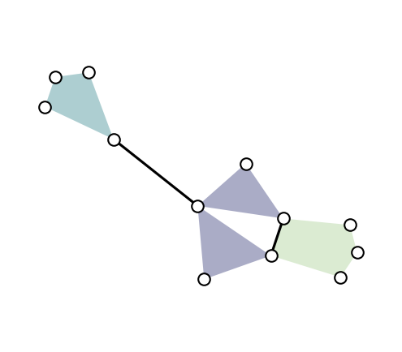

<p align="center"></img></p>

[](https://pypi.org/project/xgi/) [](https://pypi.org/project/xgi/) [](https://github.com/xgi-org/xgi/actions/workflows/test-code.yml) [](https://codecov.io/gh/xgi-org/xgi) [](https://doi.org/10.21105/joss.05162) [](https://github.com/pyOpenSci/software-review/issues/115) [](https://github.com/xgi-org/xgi/issues?q=is%3Aopen+is%3Aissue+label%3A%22Good+First+Issue%22) [](https://xgi-org.github.io/xgi/dev/bench/)

Comple**X** **G**roup **I**nteractions (**XGI**) is a Python package for [higher-order networks](https://xgi.readthedocs.io/en/stable/higher-order.html): hypergraphs, directed hypergraphs, and simplicial complexes. It provides data structures, generative models, measures, datasets, and drawing tools.

<p align="center"><a href="https://xgi.readthedocs.io">Documentation</a> · <a href="https://xgi.readthedocs.io/en/stable/user_guides.html">Tutorials</a> · <a href="https://xgi.readthedocs.io/en/stable/auto_examples/index.html">Gallery</a> · <a href="https://github.com/xgi-org/xgi-data">Datasets</a> · <a href="https://xgi.readthedocs.io/en/stable/using_xgi.html">Projects using XGI</a> · <a href="https://xgi.readthedocs.io/en/stable/contribute.html">Contribute</a></p>

## Install

```sh
pip install xgi
```

For other options (development version, optional dependencies), see the [installation guide](https://xgi.readthedocs.io/en/stable/installing.html).

## Getting started

To get started, take a look at the [tutorials](https://xgi.readthedocs.io/en/stable/user_guides.html) illustrating the library's basic functionality.

Quickstart example:

```python
import xgi

hyperedges = [[1, 2, 3], [3, 4, 5], [3, 6], [6, 7, 8, 9], [1, 4, 10, 11, 12], [1, 4]]
H = xgi.Hypergraph(hyperedges)

H.edges.size.asnumpy()          # array([3, 3, 2, 4, 5, 2])
H.nodes.filterby("degree", 3)   # nodes 1, 3, 4

pos = xgi.barycenter_spring_layout(H, seed=1)
xgi.draw(H, pos=pos)
```

<p align="center"></img></p>

## XGI-DATA

[XGI-DATA](https://xgi.readthedocs.io/en/stable/xgi-data.html) is a curated collection of 50+ real-world higher-order datasets (from face-to-face contacts and emails to coauthorships, legislation, and ecology), which can be loaded in one line with `xgi.load_xgi_data()`.

## Contribute

Contributions of any size are welcome, and we're happy to help! To report a bug or request a feature, [open an issue](https://github.com/xgi-org/xgi/issues/new). For more, see the [contributing guide](https://xgi.readthedocs.io/en/stable/contribute.html).

Join the community on [Zulip](https://xgi.zulipchat.com/join/7agfwo7dh7jo56ppnk5kc23r/) and follow XGI on [Bluesky](https://bsky.app/profile/xgi.bsky.social).

## Cite

We acknowledge the importance of good software to support research. To demonstrate the value of XGI, we ask that you cite the XGI [paper](https://doi.org/10.21105/joss.05162) in your work. You can also use the "Cite this repository" button on GitHub.

> Landry, N. W., Lucas, M., Iacopini, I., Petri, G., Schwarze, A., Patania, A., & Torres, L. (2023). XGI: A Python package for higher-order interaction networks. *Journal of Open Source Software*, 8(85), 5162.

<details>
<summary>BibTeX</summary>

```bibtex
@article{Landry_XGI_2023,
    author = {Landry, Nicholas W. and Lucas, Maxime and Iacopini, Iacopo and Petri, Giovanni and Schwarze, Alice and Patania, Alice and Torres, Leo},
    title = {{XGI: A Python package for higher-order interaction networks}},
    doi = {10.21105/joss.05162},
    journal = {Journal of Open Source Software},
    publisher = {The Open Journal},
    year = {2023},
    month = may,
    volume = {8},
    number = {85},
    pages = {5162},
    url = {https://doi.org/10.21105/joss.05162},
}
```
</details>

## License and support

Released under the [3-Clause BSD license](https://github.com/xgi-org/xgi/blob/main/LICENSE.md). XGI is supported by (see [details](https://github.com/xgi-org/xgi/blob/main/SUPPORT.md)):

<a href="https://www.nsf.gov"></img></a> &nbsp; <a href="https://zulip.com"></img></a>
