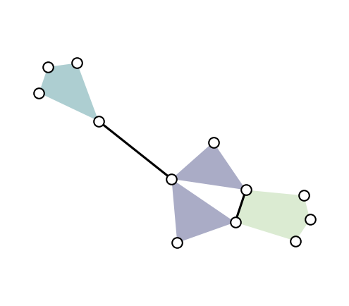

:html_theme.sidebar_secondary.remove:

.. toctree::
   :maxdepth: 1
   :hidden:

   installing
   user_guides
   api_reference
   xgi-data
   auto_examples/index
   contribute
   using_xgi

|release_announcement|

Software for higher-order networks
==================================

Comple\ **X** **G**\ roup **I**\ nteractions (XGI) is a Python package for modeling, analyzing, and visualizing `higher-order networks <higher-order.html>`_: hypergraphs, directed hypergraphs, and simplicial complexes. It covers the whole workflow, from start to finish, with data structures, generative models, measures, datasets, and drawing tools.

Higher-order networks generalize standard (pairwise) networks to interactions between any number of entities, such as collaborations between several authors or contagion in groups. For more information, see this `brief overview <higher-order.html>`_.

.. grid:: 1 2 2 2
   :gutter: 3

   .. grid-item-card:: Easy to use

      If you know NetworkX, you already know XGI: add nodes and edges, then query them, with a familiar API.

   .. grid-item-card:: Node and edge statistics

      Compute, filter, and combine node and edge statistics in one line, e.g., ``H.nodes.degree.asnumpy()`` or ``H.nodes.filterby("degree", 3)``. See the `cheatsheet <stats_cheatsheet.html>`_.

   .. grid-item-card:: Scientific Python

      Built on NumPy, SciPy, pandas, NetworkX, and matplotlib. Convert to and from matrices, dataframes, and graphs to use XGI with the rest of your tools.

   .. grid-item-card:: Real-world data

      50+ curated higher-order datasets from `XGI-DATA <xgi-data.html>`_, loaded in one line with ``xgi.load_xgi_data()``.

   .. grid-item-card:: Built by researchers

      Designed and developed by network scientists, with the latest measures, models, and algorithms from the higher-order network literature.

   .. grid-item-card:: Open source and community-driven

      BSD-licensed and developed in the open. Contributions of any size are welcome: see the `contributing guide <contribute.html>`_ or join us on `Zulip <https://xgi.zulipchat.com/join/7agfwo7dh7jo56ppnk5kc23r/>`_.

Getting started
===============

Install XGI with

.. code:: bash

   pip install xgi

For other options, see the `installation guide <installing.html>`_. Then, take a look at the `XGI in 1 minute <api/tutorials/getting_started_1.html>`_ tutorial or the other `tutorials <user_guides.html>`_.

Quickstart example:

.. code:: python

   import xgi

   # build
   hyperedges = [[1, 2, 3], [3, 4, 5], [3, 6], [6, 7, 8, 9], [1, 4, 10, 11, 12], [1, 4]]
   H = xgi.Hypergraph(hyperedges)

   # analyze
   H.edges.size.asnumpy()          # array([3, 3, 2, 4, 5, 2])
   H.nodes.filterby("degree", 3)   # nodes 1, 3, 4

   # visualize
   pos = xgi.barycenter_spring_layout(H, seed=1)
   xgi.draw(H, pos=pos)

Get involved
============

Contributions of any size are welcome, and we're happy to help! To report a bug or request a feature, `open an issue <https://github.com/xgi-org/xgi/issues/new>`_. For more, see the `contributing guide <contribute.html>`_. Browse the `projects using XGI <using_xgi.html>`_ to see how others use it, and add yours!

Join the community on `Zulip <https://xgi.zulipchat.com/join/7agfwo7dh7jo56ppnk5kc23r/>`_ and follow XGI on `Bluesky <https://bsky.app/profile/xgi.bsky.social>`_.

How to cite
===========

We acknowledge the importance of good software to support research. To demonstrate the value of XGI, we ask that you cite the XGI `paper <https://doi.org/10.21105/joss.05162>`_ in your work. You can also use the "Cite this repository" button on our `GitHub page <https://github.com/xgi-org/xgi>`_.

   Landry, N. W., Lucas, M., Iacopini, I., Petri, G., Schwarze, A., Patania, A., & Torres, L. (2023). XGI: A Python package for higher-order interaction networks. *Journal of Open Source Software*, 8(85), 5162.

.. dropdown:: BibTeX

   .. code:: text

      @article{Landry_XGI_2023,
          author = {Landry, Nicholas W. and Lucas, Maxime and Iacopini, Iacopo and Petri, Giovanni and Schwarze, Alice and Patania, Alice and Torres, Leo},
          title = {{XGI: A Python package for higher-order interaction networks}},
          doi = {10.21105/joss.05162},
          journal = {Journal of Open Source Software},
          publisher = {The Open Journal},
          year = {2023},
          month = may,
          volume = {8},
          number = {85},
          pages = {5162},
          url = {https://doi.org/10.21105/joss.05162},
      }

License
=======

Released under the `3-Clause BSD license <https://github.com/xgi-org/xgi/blob/main/LICENSE.md>`_.

Support
=======

See details `here <https://github.com/xgi-org/xgi/blob/main/SUPPORT.md>`_.
